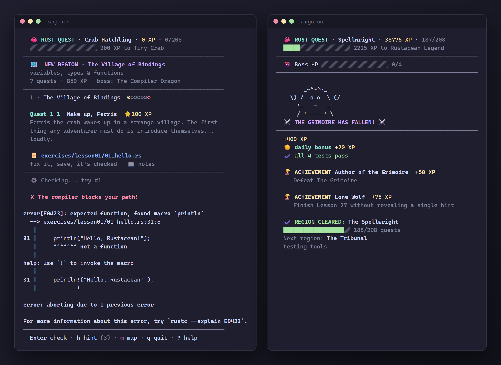

# 🦀 Rust Quest: learn Rust by playing

[](https://github.com/Kiborgik/learn-rust-quest/actions/workflows/ci.yml)
[](https://github.com/Kiborgik/learn-rust-quest/actions/workflows/starters.yml)
[](https://github.com/Kiborgik/learn-rust-quest/releases)
[](https://rustup.rs)
[](LICENSE)

A terminal game that teaches Rust through 208 small broken programs. Fix the
code, save the file, earn XP. Every lesson ends with a boss fight.

Made for people who already know another language (C#, Java, JS, Python, Go,
C++). The notes compare Rust to what you know instead of starting from zero.



Open the quest file in your editor and keep the game next to it. Save, and
it checks your code: the real compiler error, a diff of wrong output, or a
test meter. Pass to earn XP and a one-shot quiz. Each lesson is a region
that ends in a boss whose HP is its failing tests.

<details>
<summary>Text version of the screens</summary>

A broken quest:

```text
  🦀 RUST QUEST · Crab Hatchling · 0 XP · 0/208
  ░░░░░░░░░░░░░░░░░░░░ 200 XP to Tiny Crab
────────────────────────────────────────────────────────
  🗺  NEW REGION · The Village of Bindings
  variables, types & functions
  7 quests · 850 XP · boss: The Compiler Dragon
────────────────────────────────────────────────────────
  1 · The Village of Bindings  ◉○○○○○◇

  Quest 1-1  Wake up, Ferris  ⭐100 XP
  Ferris the crab wakes up in a strange village. The first
  thing any adventurer must do is introduce themselves...
  loudly.

  📜 exercises/lesson01/01_hello.rs
  fix it, save, it's checked · 📖 notes
────────────────────────────────────────────────────────
  ⚙ Checking... try #1

  ✘ The compiler blocks your path!

error[E0423]: expected function, found macro `println`
  --> exercises/lesson01/01_hello.rs:31:5
   |
31 |     println("Hello, Rustacean!");
   |     ^^^^^^^ not a function
   |
help: use `!` to invoke the macro
   |
31 |     println!("Hello, Rustacean!");
   |            +
────────────────────────────────────────────────────────
  Enter check · h hint (3) · m map · q quit · ? help
  >
```

It compiles but prints the wrong thing? You get a diff:

```text
  ✘ So close! It compiles, but...

    Hello, Rustacean!
  + Ferris has 10 legs.

  + expected  - your program printed
```

Fix it and save. XP counts up, bonuses stack, then a one-shot quiz:

```text
  ★ THE CRAB APPROVES ★
  +100 XP
  🎯 first try
  🔥 combo x2 +5 XP
  ☀ daily bonus +20 XP
────────────────────────────────────────────────────────
  🧠 BONUS QUIZ  +30 XP, one shot!

  Which line creates a variable `coins` holding 3?

  a) coins = 3;
  b) int coins = 3;
  c) let coins = 3;
  d) var coins = 3;

  Your answer: c
  ✔ Correct! +30 XP
  `let` is the only way to declare a variable in Rust. The
  type (i32 here) is inferred automatically.
────────────────────────────────────────────────────────
  ▲ ▲ ▲   RANK UP   ▲ ▲ ▲
  You are now a Tiny Crab
  Next: Shell Apprentice at 450 XP
```

Every region ends with a boss. Its HP is its failing tests, and it
drains away on the save that beats it:

```text
  ⚠ A BOSS BLOCKS THE ROAD ⚠
────────────────────────────────────────────────────────
  27 · The Spellwright  ●●●●●●◆

  👹 BOSS  The Grimoire  ⭐400 XP
  ...
  👹 Boss HP ██████████░░░░░░░░░░ 2/4 heads left
```

Press `m` for the world map:

```text
  🗺  WORLD MAP

  ▶  1 ●●◉○○○◇ The Village of Bindings
       variables, types & functions
       ✔ 1-1  Wake up, Ferris 🧠 🎯
       ✔ 1-2  Name Your Hero 🎯
       ▶ 1-3  The Ever-Changing Purse
       · 1-4  Shadow of the Scroll
       · 1-5  The Type Smith
       · 1-6  Spells & Functions
       · BOSS The Compiler Dragon
       📖 lesson notes
       🔒 Dragon Slayer
          Defeat The Compiler Dragon

  ·  2 ○○○○○○◇ The Winding Caves
  ·  3 ○○○○○○◇ The Bridge of Ownership
  ...
  · 26 ○○○○○◇  Capstone
  ...
  · 30 ○○○○○○◇ The Guild Charter
```

In a real terminal it's in color, file paths are clickable, and the layout
fits the window, down to 40 columns.

</details>

## Features

- **208 quests in 30 lessons**, from variables to async web services, plus
  the crates most projects use (serde, clap, tokio, axum, sqlx and more)
- **Learn by example**: each file starts with short, runnable examples
- **Instant feedback**: the game re-checks your file every time you save
- **Real compiler errors**, shown as they are, because reading them is the skill
- **XP, 23 ranks, achievements, daily streaks**, a bonus quiz after every quest
- **Regions and bosses**: each lesson is a region with an entrance banner;
  boss HP drops as your tests pass
- **Bonus XP** for combos (quests in a row without hints), the first quest
  of each day, and quizzes; achievements for passing on the first try
- **Hints when stuck** (they cost half the quest's XP)
- **Plain mode** for screen readers and low-contrast setups: no colors, no
  animation (`cargo run -- --plain` or `NO_COLOR=1`)
- **No dependencies** for the game: just Rust. Works on Windows, macOS and
  Linux. (From lesson 13, quests use real crates; those download once.)

## Quick start

You need Rust 1.88 or newer ([install](https://rustup.rs)).

```sh
git clone https://github.com/Kiborgik/learn-rust-quest
cd learn-rust-quest
cargo run
```

The first run copies the exercises into `exercises/`. That's your working
folder. Open it in your editor next to the terminal.

## How to play

1. The game shows the current quest and what the compiler says.
2. Open the file it points to. Read the comments at the top.
3. Fix the code and save. The game checks it right away.
4. Pass to get XP, then answer a quiz for bonus XP.

| Key | Action |
|---|---|
| save the file | check again |
| `Enter` | check again now |
| `h` | show a hint (this quest gives half XP) |
| `m` | map, achievements, streak |
| `q` | save and quit |
| `restore` | put this quest's file back to the start |
| `reset` | wipe progress and restore all files |
| `?` | list commands |

From the terminal: `cargo run -- map` shows progress, `cargo run -- reset`
starts over, `cargo run -- help` lists everything.

### Accessibility

Every state has a symbol or word, not only a color (`✔`, `✘`, `▶`,
"passing", "heads left"). For screen readers, logs or terminals without
color, use plain mode: `cargo run -- --plain`, or set `NO_COLOR=1`. It turns
off colors, the XP animation, screen clearing and escape codes, and draws
bars as `[#####-----]`. It also switches on by itself when the output isn't
a terminal.

## Lessons

| # | Topic | Level |
|---|---|---|
| 1 | [Variables, types, functions](starters/lesson01/README.md) | Basics |
| 2 | [Control flow](starters/lesson02/README.md) | Basics |
| 3 | [Ownership and borrowing](starters/lesson03/README.md) | Basics |
| 4 | [Structs and methods](starters/lesson04/README.md) | Basics |
| 5 | [Enums and pattern matching](starters/lesson05/README.md) | Basics |
| 6 | [Collections](starters/lesson06/README.md) | Basics |
| 7 | [Error handling](starters/lesson07/README.md) | Intermediate |
| 8 | [Traits and generics](starters/lesson08/README.md) | Intermediate |
| 9 | [Closures and iterators](starters/lesson09/README.md) | Intermediate |
| 10 | [Lifetimes](starters/lesson10/README.md) | Intermediate |
| 11 | [Smart pointers](starters/lesson11/README.md) | Intermediate |
| 12 | [Concurrency](starters/lesson12/README.md) | Intermediate |
| 13 | [Cargo, modules and crates](starters/lesson13/README.md) | Practical |
| 14 | [Errors in practice: thiserror, anyhow](starters/lesson14/README.md) | Practical |
| 15 | [Serialization: serde, JSON, TOML](starters/lesson15/README.md) | Practical |
| 16 | [Text tools: itertools, regex](starters/lesson16/README.md) | Practical |
| 17 | [CLI apps with clap](starters/lesson17/README.md) | Practical |
| 18 | [Data parallelism with rayon](starters/lesson18/README.md) | Practical |
| 19 | [Advanced traits and types](starters/lesson19/README.md) | Advanced |
| 20 | [Async from scratch: Future, Pin, executors](starters/lesson20/README.md) | Advanced |
| 21 | [Async with tokio](starters/lesson21/README.md) | Practical |
| 22 | [Logging with tracing](starters/lesson22/README.md) | Practical |
| 23 | [HTTP clients with reqwest](starters/lesson23/README.md) | Practical |
| 24 | [Web servers with axum](starters/lesson24/README.md) | Practical |
| 25 | [Databases with sqlx](starters/lesson25/README.md) | Practical |
| 26 | [Capstone: CLI + REST service](starters/lesson26/README.md) | Project |
| 27 | [Macros: macro_rules!](starters/lesson27/README.md) | Advanced |
| 28 | [Testing tools: rstest, proptest, insta, mockall](starters/lesson28/README.md) | Practical |
| 29 | [Unsafe and FFI](starters/lesson29/README.md) | Advanced |
| 30 | [API design idioms](starters/lesson30/README.md) | Advanced |

Lessons 1 to 12 are core Rust, std only. From lesson 13 on, quests are real
Cargo packages. All checks run offline against local test servers and
in-memory databases; crates download once on the first build.

## Editor setup

`exercises/` is its own small Cargo project. To get errors underlined in
exercise files, your editor needs to load it too. Zed, VS Code and Helix are
set up already. For other editors, add this to your rust-analyzer settings:

```jsonc
"linkedProjects": ["Cargo.toml", "exercises/Cargo.toml"],
"files": { "exclude": ["starters"] }
```

- **Neovim**: put it in the `rust-analyzer` settings table (lspconfig or rustaceanvim).
- **Emacs**: `lsp-rust-analyzer-linked-projects` (lsp-mode), or the same keys in eglot.
- **RustRover**: Cargo tool window, **+**, pick `exercises/Cargo.toml`.

Run `cargo run` once first so `exercises/Cargo.toml` exists. Restart the
language server if errors don't show up.

## How it compares to Rustlings

[Rustlings](https://github.com/rust-lang/rustlings) is great and official.
Rust Quest covers similar ground, with more game: bosses, XP, quizzes and
streaks. Its notes also target people who already program. Do both if you like.

## Folders

| Path | What | In git |
|---|---|---|
| `starters/` | original exercises and lesson notes | yes |
| `exercises/` | your copies (made on first run) | no |
| `.quest/` | your progress, backups from `restore`/`reset` | no |
| `src/` | the game | yes |

## Contributing

Found a broken or confusing quest? [Open an issue](../../issues). Want to add
a lesson? See [CONTRIBUTING.md](CONTRIBUTING.md).

## License

[MIT](LICENSE)
